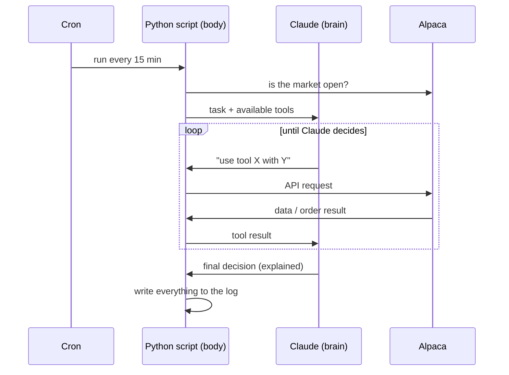

# AI Trading Agent (Paper Trading)

🇵🇹 [Versão em português](README.pt.md)

An AI agent that trades **stocks** and **crypto** on its own, using **fake money**. Claude (Anthropic's AI model) makes the decisions, and a Python script carries them out through the Alpaca paper-trading API. A cron job on Linux runs it every 15 minutes.

> ⚠️ **Educational project. Simulated money only. Not financial advice.**
> I built this to learn about AI agents, APIs and automation, not to make money.

---

## How it works

The agent has two parts:

- **The brain (Claude):** reads the situation and decides what to do. It never touches the account directly. It can only *ask* to use a tool.
- **The body (Python script):** runs on my machine, talks to Alpaca, carries out the tools, and **can refuse** a request that breaks the rules.



### Tools the agent can use

| Tool | What it does |
|---|---|
| `ver_carteira` | Cash, total value and open positions (with profit %) |
| `ver_preco` | Current bid/ask price |
| `ver_historico` | Hourly closing prices (last hours/days) |
| `ver_sinais` | Moving-average signals: **UP**, **DOWN** or **UNDEFINED** (crypto agent) |
| `comprar` | Buy (market order) |
| `vender` | Sell (market order) |

### Two independent agents

| | Stocks agent | Crypto agent |
|---|---|---|
| File | `agente_trading.py` | `agente_cripto.py` |
| Assets | AAPL, MSFT, NVDA, GOOGL, AMZN, SPY | BTC, ETH, SOL |
| Schedule | Every 15 min, weekdays, market hours | Every 15 min, 24/7 (while the machine is on) |
| Account | Alpaca paper account #1 | Alpaca paper account #2 |
| Log | `agente.log` | `agente_cripto.log` |

I used **separate paper accounts** so the two agents don't share cash or touch each other's positions, and so I can compare their results.

---

## Strategy (crypto agent): moving averages

For each crypto, the agent compares the current price with the **6-hour** and **24-hour** averages:

- **Buy:** price and 6h average are **above** the 24h average → signal **UP** → buy 5% of the portfolio (only if it doesn't already hold that crypto).
- **Sell everything** when any of these happens:
  - **Take-profit:** position at **+5%**
  - **Stop-loss:** position at **−3%**
  - **Trend:** signal turns **DOWN**

Known weakness: when the price moves sideways around the average, the signal flips back and forth, and the agent pays fees going in and out. I've already seen this happen with BTC.

---

## Safety rules (enforced in code, not just in the prompt)

The AI can *ask* for anything, but the script only carries out what the rules allow:

- `paper=True`, so the agent only ever uses the simulated account.
- **Whitelist** of allowed symbols.
- **Max 10% of the portfolio per buy order.**
- **Can't sell more than it holds.** This blocks accidental short selling. The symbol check also handles the `BTCUSD` vs `BTC/USD` format difference.
- `MAX_PASSOS = 10`, so the agent loop can't run forever.
- If the market is closed, the script exits **before** calling Claude, so it costs nothing.
- API keys live in a `.env` file (`chmod 600`), never in the code.

---

## Tech stack

Python 3 · [Anthropic API](https://docs.claude.com) (Claude Haiku, tool use) · [Alpaca](https://alpaca.markets) (`alpaca-py`, paper trading) · Ubuntu Linux · cron · python-dotenv

**Cost:** about $0.13 per 100 agent runs with Claude Haiku. That's roughly $2–3 per month.

---

## Setup

```bash
git clone https://github.com/diosilv002/agente-trading-ia.git
cd agente-trading-ia
python3 -m venv venv
source venv/bin/activate
pip install -r requirements.txt

cp .env.example .env      # then fill in your own keys
chmod 600 .env

python3 agente_trading.py   # stocks agent
python3 agente_cripto.py    # crypto agent
```

Run them automatically with cron (`crontab -e`):

```
*/15 14-21 * * 1-5 cd /path/to/repo && venv/bin/python agente_trading.py >> agente.log 2>&1
*/15 * * * *       cd /path/to/repo && venv/bin/python agente_cripto.py  >> agente_cripto.log 2>&1
```

(Times are in Portugal time. The US market opens at 14:30 and closes at 21:00.)

---

## Problems I ran into (and solved)

- **Wrong-looking API key:** my Claude key started with `sk-ant-usr` instead of `sk-ant-api`. The format was fine. The real issue was a bad copy-paste.
- **`.env` not being read:** a `KeyError` turned out to be an outdated script that had never loaded the `.env` file.
- **Crypto orders need `GTC`**, not `DAY` like stocks.
- **Symbol format:** positions come back as `BTCUSD`, but orders use `BTC/USD`. I fixed this with `simbolo.replace("/", "")`.
- **Network drops:** a DNS failure crashed one run. The next cron run picked up normally.
- **US holidays:** on Thanksgiving the agent correctly said "market closed", because it checks Alpaca's market clock.

---

## Results so far

Early days. Only a few days of simulated trading, which is far too short to conclude anything.
The stocks agent bought AAPL after spotting the only upward trend among its 6 stocks. The crypto agent stayed out during a ~4% drop, then bought all three when the trend turned up.

The real test will be comparing it, over 1–3 months, against simply buying SPY and holding.

---

## Roadmap

- [ ] Log the API cost of each run
- [ ] Memory between runs (save previous decisions to a file)
- [ ] Run on a cloud server, so it doesn't depend on my laptop
- [ ] Store decisions in a database (PostgreSQL)
- [ ] Backtesting with historical data
- [ ] Compare strategies: AI vs fixed rules vs buy-and-hold

---

## What I learned

This project has been very rewarding, both for deepening my technical knowledge and for my personal growth. Even though I'm building it with the help of AI, it still takes critical thinking, technical knowledge and, above all, a real will to learn.

An API (Application Programming Interface) is an agreed way for programs to talk to each other. In this project, my Python script talks to Claude on one side and to Alpaca on the other. Claude and Alpaca never talk to each other directly. The script is the bridge between them.

The script itself is built mostly on things I've learned at university, mainly functions (`def`), loops and `if` statements. Applying them in a real project helped me understand what each piece actually does.

This project was also my first real step into Linux. Everything runs on Ubuntu, which means getting comfortable with the terminal: virtual environments, cron, file permissions and environment variables. AI has been a great teacher here.

Last but not least: the prompt guides the AI's decisions, but the code has the final say. That's why the important rules, like spending limits and the ban on selling more than it holds, have to live in the code. The AI can ask for anything, but the script only carries out what the rules allow.

---

## About

Built by **Diogo Sousa**, a first-year Computer Engineering student (ISLA Gaia, Portugal), while working full-time in industrial production.
I built this project **with the help of AI (Claude)** as a learning partner. I wrote parts of the code myself (for example, the sell protection) and I can explain every part of how it works.
