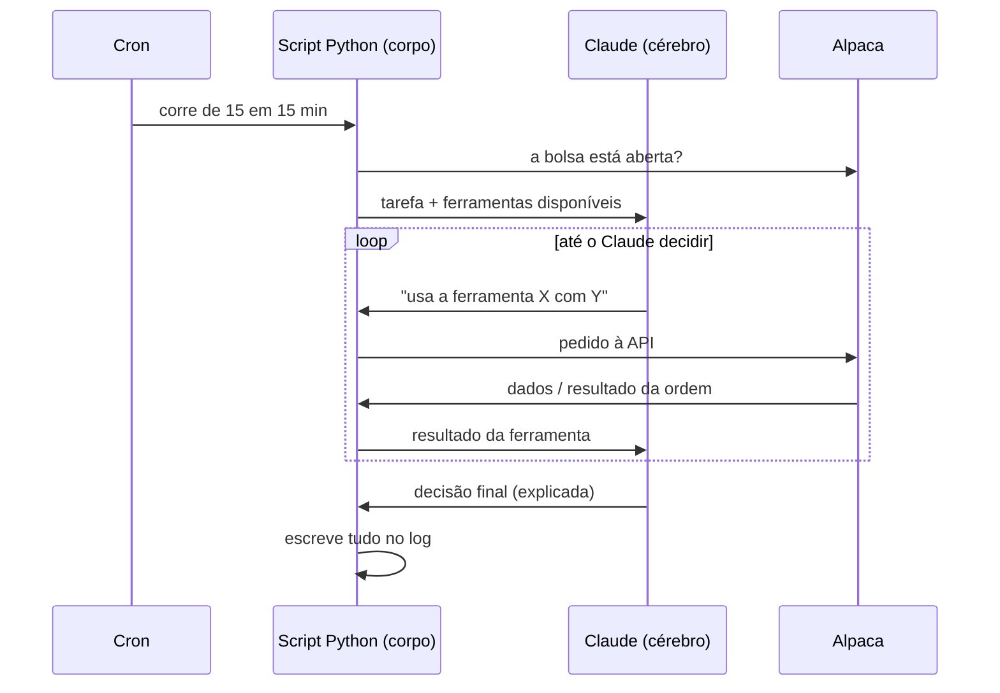

# Agente de IA de Trading (Paper Trading)

🇬🇧 [English version](README.md)

Um agente de IA que faz trading de **ações** e **criptomoedas** sozinho, com **dinheiro fictício**. As decisões são do Claude (o modelo de IA da Anthropic), e um script em Python executa-as através da API de paper trading da Alpaca. O cron do Linux corre-o de 15 em 15 minutos.

> ⚠️ **Projeto educativo. Só dinheiro simulado. Não é aconselhamento financeiro.**
> Fiz este projeto para aprender sobre agentes de IA, APIs e automação, não para ganhar dinheiro.

---

## Como funciona

O agente tem duas partes:

- **O cérebro (Claude):** analisa a situação e decide. Nunca mexe na conta diretamente: só pode *pedir* para usar uma ferramenta.
- **O corpo (script Python):** corre no meu computador, fala com a Alpaca, executa as ferramentas e **pode recusar** um pedido que viole as regras.



### Ferramentas do agente

| Ferramenta | O que faz |
|---|---|
| `ver_carteira` | Dinheiro, valor total e posições abertas (com lucro em %) |
| `ver_preco` | Preço atual de compra e de venda |
| `ver_historico` | Preços de fecho de hora a hora (últimas horas ou dias) |
| `ver_sinais` | Sinais das médias móveis: **SUBIDA**, **DESCIDA** ou **INDEFINIDO** (agente de cripto) |
| `comprar` | Comprar (ordem a mercado) |
| `vender` | Vender (ordem a mercado) |

### Dois agentes independentes

| | Agente de ações | Agente de cripto |
|---|---|---|
| Ficheiro | `agente_trading.py` | `agente_cripto.py` |
| Ativos | AAPL, MSFT, NVDA, GOOGL, AMZN, SPY | BTC, ETH, SOL |
| Horário | De 15 em 15 min, dias úteis, com a bolsa aberta | De 15 em 15 min, 24/7 (com o computador ligado) |
| Conta | Conta paper n.º 1 da Alpaca | Conta paper n.º 2 da Alpaca |
| Log | `agente.log` | `agente_cripto.log` |

Usei **contas paper separadas** para os dois agentes não partilharem dinheiro nem mexerem nas posições um do outro, e para poder comparar os resultados.

---

## Estratégia (agente de cripto): médias móveis

Para cada cripto, o agente compara o preço atual com as médias das **últimas 6 horas** e das **últimas 24 horas**:

- **Compra:** o preço e a média de 6h estão **acima** da média de 24h → sinal **SUBIDA** → compra 5% da carteira (só se ainda não tiver essa cripto).
- **Vende tudo** em qualquer um destes casos:
  - **Take-profit:** a posição chega a **+5%**
  - **Stop-loss:** a posição chega a **−3%**
  - **Tendência:** o sinal passa a **DESCIDA**

Ponto fraco conhecido: quando o preço anda para os lados à volta da média, o sinal muda várias vezes e o agente paga comissões a entrar e a sair. Já vi isto acontecer com o BTC.

---

## Regras de segurança (no código, não só no prompt)

A IA pode *pedir* o que quiser, mas o script só executa o que as regras permitem:

- `paper=True`: o agente só usa a conta simulada.
- **Lista fechada** de símbolos permitidos.
- **Máximo de 10% da carteira por compra.**
- **Não pode vender mais do que tem.** Isto evita vendas a descoberto acidentais. A verificação também resolve a diferença entre `BTCUSD` e `BTC/USD`.
- `MAX_PASSOS = 10`: o ciclo do agente não pode correr para sempre.
- Se a bolsa estiver fechada, o script sai **antes** de chamar o Claude, por isso não gasta nada.
- As chaves de API ficam num ficheiro `.env` (`chmod 600`), nunca no código.

---

## Tecnologias

Python 3 · [API da Anthropic](https://docs.claude.com) (Claude Haiku, tool use) · [Alpaca](https://alpaca.markets) (`alpaca-py`, paper trading) · Ubuntu Linux · cron · python-dotenv

**Custo:** cerca de 0,13 dólares por cada 100 execuções do agente com o Claude Haiku. Dá uns 2 a 3 dólares por mês.

---

## Instalação

```bash
git clone https://github.com/diosilv002/agente-trading-ia.git
cd agente-trading-ia
python3 -m venv venv
source venv/bin/activate
pip install -r requirements.txt

cp .env.example .env      # depois preenche com as tuas chaves
chmod 600 .env

python3 agente_trading.py   # agente de ações
python3 agente_cripto.py    # agente de cripto
```

Para correrem sozinhos, com o cron (`crontab -e`):

```
*/15 14-21 * * 1-5 cd /caminho/do/repo && venv/bin/python agente_trading.py >> agente.log 2>&1
*/15 * * * *       cd /caminho/do/repo && venv/bin/python agente_cripto.py  >> agente_cripto.log 2>&1
```

(Horas de Portugal. A bolsa dos EUA abre às 14:30 e fecha às 21:00.)

---

## Problemas que encontrei (e resolvi)

- **Chave de API com ar de errada:** a minha chave do Claude começava por `sk-ant-usr` em vez de `sk-ant-api`. O formato estava certo. O problema verdadeiro era uma cópia mal feita.
- **O `.env` não era lido:** um `KeyError` afinal vinha de uma versão antiga do script, que nunca chegava a carregar o `.env`.
- **As ordens de cripto precisam de `GTC`**, e não de `DAY` como as ações.
- **Formato dos símbolos:** as posições vêm como `BTCUSD`, mas as ordens usam `BTC/USD`. Resolvi com `simbolo.replace("/", "")`.
- **Falhas de rede:** uma falha de DNS fez uma execução falhar. A execução seguinte do cron correu normalmente.
- **Feriados nos EUA:** no Thanksgiving, o agente disse corretamente "bolsa fechada", porque consulta o relógio de mercado da Alpaca.

---

## Resultados até agora

Ainda é muito cedo. São poucos dias de trading simulado, o que não chega para tirar conclusões.
O agente de ações comprou AAPL depois de ver que era a única das 6 ações em tendência de subida. O agente de cripto ficou de fora durante uma queda de ~4% e depois comprou as três quando a tendência inverteu.

O teste a sério vai ser compará-lo, ao fim de 1 a 3 meses, com simplesmente comprar SPY e esperar.

---

## Próximos passos

- [ ] Registar o custo da API de cada execução
- [ ] Memória entre execuções (guardar as decisões anteriores num ficheiro)
- [ ] Correr num servidor na cloud, sem depender do portátil
- [ ] Guardar as decisões numa base de dados (PostgreSQL)
- [ ] Backtesting com dados históricos
- [ ] Comparar estratégias: IA vs. regras fixas vs. comprar e esperar

---

## O que aprendi

Este projeto tem sido bastante enriquecedor, não só para o aprofundamento dos meus conhecimentos como também para o meu desenvolvimento pessoal. Apesar de estar a ser realizado com ajuda de IA, exige pensamento crítico, conhecimentos técnicos e, acima de tudo, vontade de aprender.

Uma API, como o nome indica, é uma interface de programação de aplicações que permite a comunicação entre vários programas. Neste projeto, o meu script em Python comunica com o Claude de um lado e com a Alpaca do outro. O Claude e a Alpaca nunca falam diretamente: o script é a ponte entre os dois.

A estrutura do script foi construída essencialmente com conhecimentos já adquiridos na universidade, nomeadamente funções (def), ciclos e ifs. Foi ótimo, porque me permitiu aplicar o que aprendi num projeto real e perceber o que realmente cada coisa faz.

Outro ponto relevante foi a minha "entrada" no mundo Linux. Todo o projeto está a ser desenvolvido em Ubuntu, o que requer uma certa destreza, principalmente no terminal: ambientes virtuais, cron, permissões de ficheiros e variáveis de ambiente. A IA tem sido uma ótima professora nesse aspeto.

Por fim, e não menos importante: o prompt orienta as decisões da IA, mas quem tem a última palavra é o código. Por isso, as regras mais importantes, como os limites de gasto e a proibição de vender mais do que se tem, têm de estar no código. A IA pode pedir o que quiser, mas o script só executa o que as regras permitem.

---

## Sobre

Feito por **Diogo Sousa**, estudante do 1.º ano de Engenharia Informática (ISLA Gaia, Portugal), enquanto trabalho a tempo inteiro em produção industrial.
Fiz este projeto **com a ajuda de IA (Claude)** como parceira de aprendizagem. Escrevi partes do código sozinho (por exemplo, a proteção das vendas) e consigo explicar cada parte do funcionamento.
